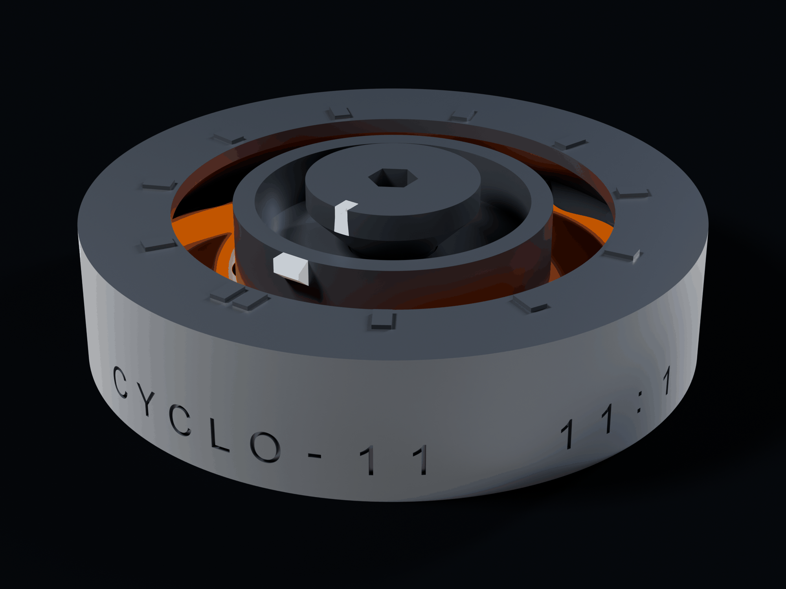
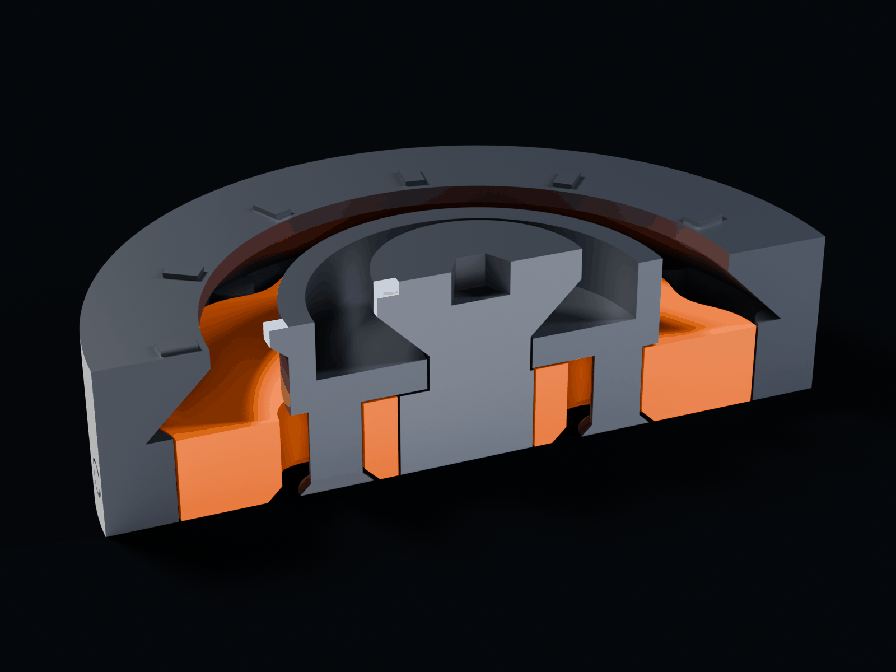
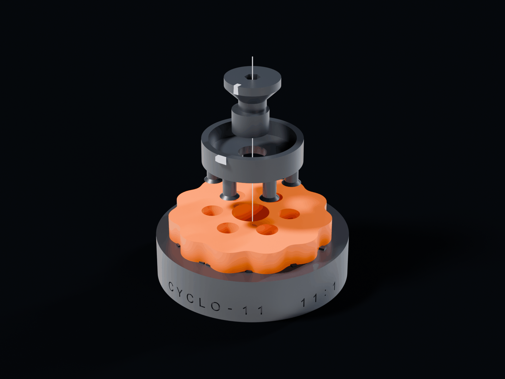
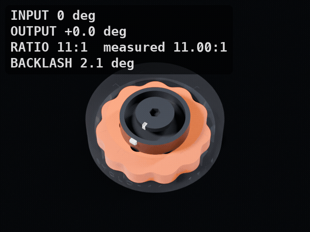
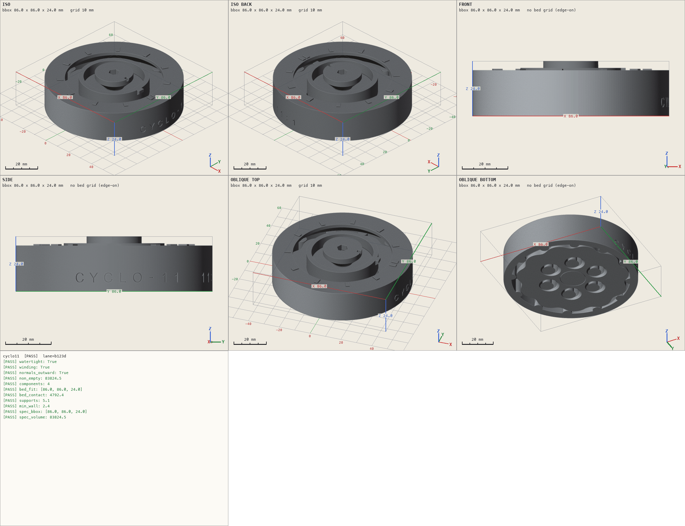
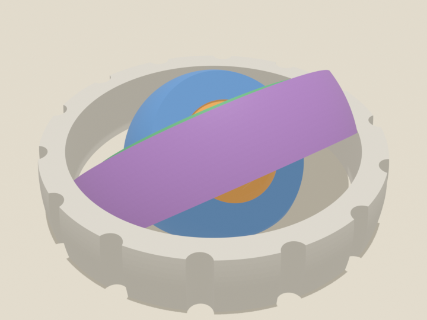
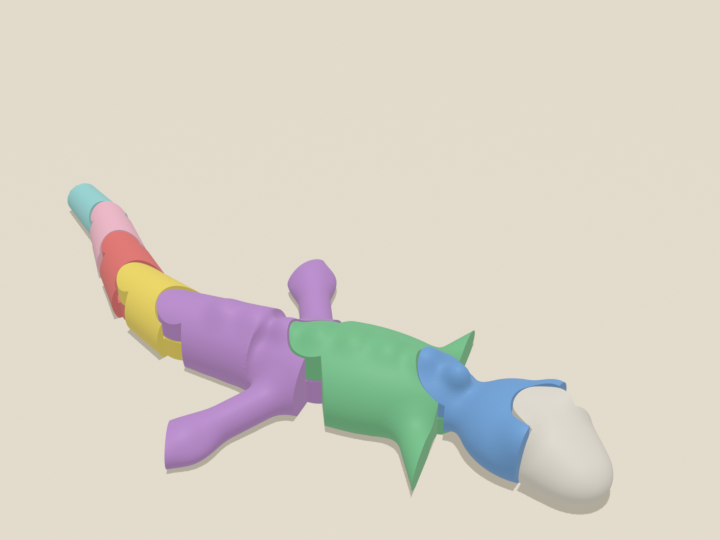
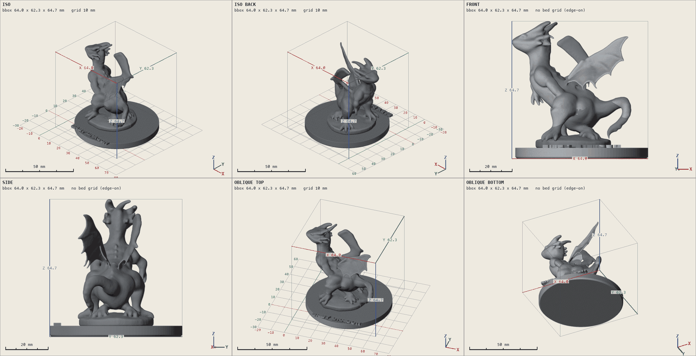

# Mold3D

**AI that designs 3D prints that actually work, and proves it before you hit print.**

- **Design a part from a sentence.** "A wall mount for a 38 mm sensor", "a print-in-place gear fidget", "a box with a sliding lid".
- **Catches print failures before you waste plastic.** Checks your part layer by layer for floating pieces, gaps that fuse shut, supports that weld moving parts together, and parts that tip over.
- **Print-in-place mechanisms that come off the bed already moving.** Gears, hinges, gearboxes, checked through their full range of motion first.
- **Works in Claude Code and Codex.** Free, MIT licensed, runs on your machine.

```bash
curl -fsSL https://raw.githubusercontent.com/marklkasdorf-del/mold3d/main/install.sh | bash
```

1. Paste that into Terminal and press Enter. Wait about 3 minutes (it asks you one question: which printer you have).
2. Open a new Terminal tab.
3. Type `claude`, then type `/mold3d a phone stand for my iPhone`.

**Or let your AI do it.** Paste this into Claude Code or Codex:

```
Install Mold3D for me: run `curl -fsSL https://raw.githubusercontent.com/marklkasdorf-del/mold3d/main/install.sh | bash`, pick my printer if it asks, then tell me what it printed at the end.
```

Then in Claude Code: `/mold3d <what you want>`

### How it works
Mold3D is a [Claude Code](https://claude.com/claude-code) skill (and a plain Python CLI, `forge`) that turns an idea into a printable STL through code-CAD (build123d / OpenSCAD / Blender bpy), then **proves** the result before any plastic is spent: dimensions against a numeric spec, wall thickness, motion sweeps for anything that moves, fit/clearance checks, renders you can read, and a layer-by-layer **preflight** that predicts print failures (knife-edge bed contact, mid-air islands, fused gaps, auto-support traps, tip-over).

## Showpiece: CYCLO-11, a print-in-place cycloidal speed reducer

**One print. 11:1. Ratio -10.9998:1 and 2.1 deg of backlash, measured from the geometry before any plastic.** Four bodies (housing, eccentric disc, output carrier, input shaft), one plate, no assembly, no supports in the design. Built and checked with this skill's own loop.

<p align="center">
  
  
</p>
<p align="center">
  
  
</p>
<p align="center"><sub>Renders (Cycles, "studio" style), not photos. The GIF replays the exact Moves the self-test swept; the overlay numbers come from `ratio.json`.</sub></p>

| check (all from this run's tool output) | result |
|---|---|
| static overlaps, every body pair | none (0.000 mm3) |
| sweep `reduce` (37 poses, full input turn) / `mesh` (13 poses) | worst overlap 0.000 / 0.000 mm3 |
| must-jam controls (half a lobe pitch, cam alone, carrier alone) | all 3 jam |
| gaps at the gap pose (housing-disc, disc-carrier, disc-shaft, carrier-shaft) | 0.300 / 0.300 / 0.300 / 0.300 mm, tightest 0.300 |
| **measured ratio** (`forge mech ratio cyclo11`, 24 poses, full turn) | **-10.9998 : 1** (declared -11, within 0.5 %) |
| **measured backlash** at the output | **2.10 deg = 126 arcmin** (min 2.05, max 2.29 over 24 poses) |
| `forge movecheck` | 4 bodies, 0 interpenetration, min gap 0.300 mm |
| `forge run` verify | PASS: bbox 86 x 86 x 24 mm, 4 components, 83.8 cm3, min wall 2.4 mm |
| `forge preflight` | CAUTION only from the `pip` first-layer note; no floating islands, unsupported overhang 0.8 mm2, one bridge of 16.3 mm; **auto-support traps: 2 regions, 974 mm2 of flat underside 0.30 mm over another body -> SUPPORTS: OFF (required)** |

**PRINT NOTE: supports OFF, no brim, print `examples/cyclo11/cyclo11_SUPPORTS-OFF.3mf` (made by `forge export`).** A slicer's "auto supports" fills the 0.3 mm gaps under the flat carrier plate and welds the parts. Honest history: the first real print of this part was ruined exactly that way (auto supports ticked, the gearbox tore into 3 pieces on removal), which is why preflight now has an auto-support trap check and `forge export` exists. See [`examples/cyclo11/PRINT-NOTE.md`](examples/cyclo11/PRINT-NOTE.md).

The gaps and the ratio are **verified in geometry, not on real plastic**: print the Fit Card, run `forge fit set pip_gap <n>`, rebuild, and every gap re-flows. Backlash here is the output carrier's free play with the cam and disc held (the disc's own lobe/pin play is not included). The files are in [`examples/cyclo11/`](examples/cyclo11/) (STLs, `spec.json`, `selftest.json`, `ratio.json`, `preflight.json`).

### How the cycloidal build works
- **Exact profile** (`lib/cycloid.py`): 12 pins on R = 38, 11 lobes, eccentricity 1.5 (47 % of the pin pitch), pins inflated by the print gap so the clearance is uniform along the whole flank. `checks()` asserts a simple polygon, 11 lobes, r_max = 36.20, r_min = 33.20, no undercut (smallest convex radius of curvature 12.3 mm vs the 3.3 mm inflated pin).
- **Everything grows from the bed**: housing wall and pins, the disc, the carrier pins (45 degree base flares caught by 45 degree counter-cones in the disc), the cam. Every overhang is a 45 degree cone, so the plate over the stack is the only bridge.
- **The wall is sized from the motion**: the farthest lobe tip reaches 37.7 mm from the axis during the cycle, so `cycloidal.build()` computes the housing wall (38.0) instead of guessing.
- **Parametric**: `forge mech build cycloidal N=16 R=45` builds a 15:1 (the profile checks run first and raise on an undercut).
- **Measured, not declared**: `forge mech ratio` poses the mechanism, frees the output and bisects for the contact-free angle interval, 24 times around the turn.

```bash
forge mech build cyclo11                                    # build + self-test + export (about 2 min)
forge mech ratio cyclo11                                    # measured ratio + backlash -> mold3d/cyclo11/ratio.json
forge mech ratio planetary --motion mesh --driven ring --driver sun      # same tool on the planetary: -1/3
forge run examples/cyclo11/cyclo11_part.py --name cyclo11 --spec examples/cyclo11/spec.json
forge preflight mold3d/cyclo11/cyclo11.stl
forge export mold3d/cyclo11/cyclo11.stl                        # -> cyclo11_SUPPORTS-OFF.3mf: the supports decision travels with the file
forge showcase mold3d/cyclo11 --style studio --still hero      # also: cutaway (y=0 section), exploded
forge showcase mold3d/cyclo11 --motion reduce --style studio --ghost housing --annotate --elev 55
```

New render flags (`forge showcase`, Blender): `--style studio|paper` (studio = Cycles + denoise, AgX, dark field with a shadow-catcher floor, graphite material, 3-light rig, 85 mm camera fitted to the part), `--accent PART[,PART]` (orange part), `--ghost PART` (12 % alpha, no shadow), `--section x|y|z=VAL` (boolean cut per part, cap faces coloured), `--explode` (offsets from `meta.explode`, with an axis line), `--still hero|cutaway|exploded`, `--annotate` (INPUT / OUTPUT angle, ratio, measured ratio and backlash burned into every frame), plus `--samples`, `--elev`, `--az`, `--fill`, `--yshift`. `forge mech ratio` exits 3 when the measured ratio differs from the declared one by more than 0.5 % (`--declared N` overrides the declared value).


<p align="center"><sub>The verification sheet `forge run` writes for every iteration: six views, bbox, scale bars, grid, checks.</sub></p>

## More examples

<p align="center">
  
  
  
</p>
<p align="center"><sub>Print-in-place planetary gears, a gyroscope and an articulated gecko: all generated by code, each one swept through its full motion range (and a must-jam control) before export. Renders, not photos: see "What is not proven yet".</sub></p>

<p align="center"></p>

---

---

## Contents
- [CYCLO-11](#showpiece-cyclo-11-a-print-in-place-cycloidal-speed-reducer) · [Why it works](#why-it-works) · [What it does](#what-it-does) · [Benchmark](#benchmark-honest-numbers) · [Install](#quickstart)
- [Command reference](#command-reference) · [How the loop works](#how-the-loop-works) · [Prompts](#example-prompts)
- [Repo layout](#repo-layout) · [Roadmap](#roadmap) · [Contributing](#contributing) · [Credits and licenses](#credits-and-licenses)

## Why it works

LLMs write plausible CAD scripts, but they cannot see an STL, they misremember dimensions, and a boolean that silently does nothing looks identical to one that worked. Mold3D's answer is boring and effective:

1. **Spec first, with numbers.** `spec.md` + `spec.json` hold the success criteria (bbox, volume, wall, component count, fit).
2. **One change per iteration.** Every iteration is saved; `forge run` rebuilds, runs `verify`, renders a 6-view annotated sheet, and writes `REPORT.md`.
3. **Numbers beat pictures.** Claims about geometry must come from a tool's JSON (verify, selftest, preflight, grade) or a render read that iteration.
4. **Anything that moves ships with a self-test**: sweep every pose clear, a *must-jam* negative control checked along its whole path, and exact measured gaps.
5. **Preflight before the slicer**; its verdict (GO / CAUTION / GO+SUPPORTS / NO-GO) decides supports and blocks bad prints.
6. **Know the weak spot.** Hand-modeled organic and iconic shapes look like blobs, so the skill routes those to find-and-remix, local text-to-3D, or flexify instead of pretending.

## What it does

| Area | Commands | What you get |
|---|---|---|
| **Build + verify loop** | `forge run`, `verify`, `render`, `topo`, `step2stl`, `parts-find` | build123d / OpenSCAD / bpy parts, numeric checks, annotated sheets, addressable faces ("the hole at `s1.f7`"), real standard-part dimensions from STEP |
| **MechKit** | `forge mech list / build / test / ratio` | Verified print-in-place mechanisms (with a measured ratio + backlash tool): Fit Card calibration print, gyroscope, planetary gears, cycloidal reducer, balisong trainer, helix pass-through, pin hinge, plus a `Mech` API for new ones |
| **Flexify** | `forge flexify` | Any creature mesh -> print-in-place articulated "flexi" (lap joints on cone pins, joint self-test) |
| **Text -> 3D (local)** | `forge text3d "<idea>"` | LCM-Dreamshaper concept -> Hunyuan3D-2mini shape -> watertight, scaled, flat-based figure + preflight. Optional `--flexi`, `--helmet` (wearable, sized to a head) |
| **Remix** | `forge remix <stl> text / keychain / magnets / thicken / fit-head / flat / mirror / scale` | Upgrade any download: text that follows curves, keychain loop, magnet pockets with real walls, medial-surface wall thickening, scale-to-head |
| **Make** | `forge make box / keychain / sign / holder / stand / lithophane` | Practical generators from your numbers; box lids are motion-checked |
| **Plate** | `forge plate` | Pack many parts on the bed, per-item cost |
| **Split** | `forge split` | Bed-sized pieces with the smallest seams, alignment pins, engraved seam IDs |
| **Gridfinity + Photofit** | `forge gridfinity`, `forge photofit` | Gridfinity bins/baseplates to spec; a photo of an object on a printed ArUco mat -> exact outline -> custom pocket bin |
| **Preflight** | `forge preflight`, `forge heat` | Failure prediction + red/yellow support heatmap |
| **Looks score** | `forge looks` | CLIP recognizability score on clean renders ("would a stranger name this?") |
| **Show it** | `forge ar`, `forge showcase` | USDZ/GLB real-size AR files; verified-motion video + GIF + listing kit |
| **Fit table** | `forge fit show / set` | One clearance table every generator reads; measure once on your printer, everything adapts |
| **Printer-agnostic** | `knowledge/printer.json` | Bed, nozzle, layer height. Slicing is your slicer of choice |

## Benchmark (honest numbers)

Single author run on 2026-10-17, one model (Claude), n = 1 per item. Treat it as a worked case study, not a controlled study. Full write-up: [`knowledge/benchmark-2026-10-17.md`](knowledge/benchmark-2026-10-17.md).

**Round A, accuracy.** Standard parts modeled blind (name/standard only), scored against the real STEP from step.parts by voxel IoU:

| part | IoU | what went wrong |
|---|---|---|
| 608ZZ bearing | **0.971** | nothing notable |
| ISO 4762 M5x16 screw | **0.959** | nothing notable |
| ISO 4032 M8 nut | 0.817 | height 6.8 vs 6.5, bore too small |
| 2020 B-slot profile | 0.765 | slot internals guessed |
| NEMA17 L40 motor | 0.770 | shaft far too long (1.98 mm mean error) |
| GT2 20T pulley | **0.407** | invented a hub |

Fully specified parts come out near human-with-calipers quality (~0.96); every guessed detail is a miss. The fix is built in: **look dimensions up (`forge parts-find`, datasheets), never recall them.** A Gridfinity bin scored 0.74 from memory of the spec and **0.93** after measuring a real community bin.

**Round B, things that move**, same checks as the most popular community models (`forge movecheck` + motion sweep):

| item | community champion gaps | skill gaps | motion | looks |
|---|---|---|---|---|
| balisong trainer | 0.25 mm, fuse 0 | 0.29 mm, fuse 0 | sweep 0-180 deg clear on the **first build** | human wins (first try was a flat stick; second try closer, still behind) |
| planetary spinner | 0.04 mm, fuse-risk 225 mm2 | 0.36 mm, fuse 0 | tooth-pitch sweep clear | about a tie |
| spiral fidget | two-piece | 0.4 mm | pass-through clear + control jams | **built the wrong toy** (a pass-through, theirs is a finned cone) |
| superhero helmet | popular community model | 3 pieces, magnets | n/a | **human by a mile** (the hand-modeled one was an egg) |

**Looks Score** (CLIP on clean renders) ranked every pair the way a human did (balisong 60% > 42% > 28%; real helmet 13.5% vs egg 0.9%). **Text-to-3D** produced four readable figures in about 3.5 minutes each on Apple silicon; **flexify** on an SDF gecko gave 7 joints, all +-22 deg clear, 0.30 mm gaps; **photofit** recovered a synthetic 72 x 24 mm object within -0.12 / -0.25 mm.

**Where it is weak** (so you do not have to find out the hard way):
- Hand-modeled organic or iconic shapes look like blobs. Use find-and-remix, `text3d`, or flexify.
- Fine detail from text-to-3D is soft at ~60 mm and figures need supports; flexi-from-text is chunky.
- Guessed or recalled dimensions miss badly (see Round A).
- It can build the wrong toy if you skip the reference pass (see the spiral fidget).
- Threads and complex linkages (> 5 moving parts) are unreliable.

### What is not proven yet
Most print-in-place gaps in the benchmark (0.29-0.36 mm) are **verified in geometry, not on real plastic**, and CYCLO-11 itself has not been printed yet. The first real result is the **Fit Card** (`forge mech build fitcard`, about an hour, ~16 g), which measures your printer's real gaps; `forge fit set` writes them into the one table all generators read. On 2026-11-13 it was printed on an Anycubic Kobra X (supports off): spinners at 0.20 mm and wider broke free, 0.15 mm fused; hinges at 0.35 mm and wider folded, 0.25 mm fused. So `pip_gap` 0.20 / `pip_vgap` 0.35 on that printer. That is one printer; the shipped default stays as is until you calibrate yours, and until then every print-in-place design carries a preflight CAUTION by design. The images above are renders.

## Quickstart

**One command** (macOS or Linux, no sudo; installs into `~/.claude/skills/mold3d`, links it for Codex if you have `~/.codex`, asks which printer you have, and runs a self-test; re-run it any time to upgrade; add `MOLD3D_VERBOSE=1` to see every technical detail, otherwise the raw output goes to `install.log` in the install folder):

```bash
curl -fsSL https://raw.githubusercontent.com/marklkasdorf-del/mold3d/main/install.sh | bash
```

It uses [uv](https://docs.astral.sh/uv/) if you have it, otherwise Python 3.10-3.12 on your PATH. Options: `MOLD3D_DIR`, `MOLD3D_PRINTER=prusa-mk4` (skip the menu), `MOLD3D_REF` (branch).

### Manual install

Requirements: Python 3.10-3.12, [Blender](https://www.blender.org) 4.x/5.x (renders and showcase videos; optional but strongly recommended), OpenSCAD (optional, scad lane), ffmpeg (optional, showcase). macOS (Apple silicon) is what it was built on; Linux should work; Windows is untested.

```bash
# 1. install as a Claude Code skill (or just clone anywhere and use bin/forge)
git clone https://github.com/marklkasdorf-del/mold3d ~/.claude/skills/mold3d
cd ~/.claude/skills/mold3d

# 2. CAD environment (everything except text3d / looks)
python3.12 -m venv .venv-cad
.venv-cad/bin/pip install -r requirements-cad.txt
.venv-cad/bin/pip install git+https://github.com/fogleman/sdf.git     # SDF organic lane

# 3. pick your printer (default: generic 220 x 220 x 250, 0.4 nozzle)
cp knowledge/printers/prusa-mk4.json knowledge/printer.json           # then edit bed / nozzle / layer

# 4. check
bin/forge doctor
bash tests/run_suite.sh                                               # known-answer tests, no Blender needed
```

**Optional: local text-to-3D (`forge text3d`) and `forge looks`.** Needs a GPU (Apple MPS or CUDA; CPU works but is slow) and several GB of downloads.

```bash
python3.12 -m venv .venv-ai
.venv-ai/bin/pip install -r requirements-ai.txt                       # install the right torch build for your hardware first if needed
git clone https://github.com/Tencent-Hunyuan/Hunyuan3D-2 lib/text3d/Hunyuan3D-2
bin/forge text3d "friendly axolotl" --height 60                       # first run downloads the model weights
```

**No model weights are included in this repo.** LCM-Dreamshaper-v7, Hunyuan3D-2mini, CLIP and rembg download from their upstream sources on first use and are subject to their own licenses (Hunyuan3D has a Tencent community license with territory and usage terms: see its license before using or selling anything it generates). Details in [THIRD_PARTY_NOTICES.md](THIRD_PARTY_NOTICES.md).

**Environment variables:** `FORGE_CAD_PY`, `FORGE_AI_PY` (interpreters; default `<skill>/.venv-cad`, `<skill>/.venv-ai`), `FORGE_PRINTER` (profile path), `FORGE_SLICER_CMD` (optional slicer hook), `FORGE_FIT` (fit table path), `BLENDER`, `OPENSCAD`.

**Slicing.** forge ends at a verified STL plus a supports decision; slice with whatever you use. If you want print time and grams inside `preflight --slice`, `plate --slice` and `text3d`, set `slicer_cmd` in `knowledge/printer.json` (or `FORGE_SLICER_CMD`) to a shell template with `{stl}` and `{supports}` whose output contains `printing time: ...` and `total filament used [g]: ...` lines.

**Agent sandboxes.** Blender, OpenSCAD and GPU torch can crash inside sandboxes that hide the GPU (Blender exits 139). Run those steps outside the sandbox; pure-python steps are fine inside.

## Example prompts

```
/mold3d a wall mount for a 38 mm round sensor, two M3 screws, must print without supports
/mold3d print-in-place gear fidget, about 50 mm, planetary
/mold3d flexi axolotl, 120 mm long
/mold3d make me a box 80 x 60 x 40 with a sliding lid and a label that says SCREWS
/mold3d will this print? (attach bracket.stl)
/mold3d add my name to the top of this STL and a keychain loop
/mold3d this statue is 290 mm tall and my bed is 220: split it
/mold3d insert for my 72 x 24 mm multitool in a gridfinity drawer (I will photograph it on the mat)
/mold3d text to 3D: a baby dragon sitting on a plinth
```

## Command reference

`bin/forge <cmd>` (also `bin/verify`, `bin/render`, `bin/blender_py`). `forge --help` lists everything.

| command | usage |
|---|---|
| `doctor` | check Blender, OpenSCAD, venvs, optional models, printer profile |
| `run` | `forge run part.py [--lane b123d\|scad\|bpy] [--spec spec.json] [--name N] [--section z=5] [--ref img] [--eevee] [--no-render]` -> `mold3d/<name>/` with STL, sheet, verify.json, REPORT.md, `iter_NN/` |
| `verify` | `forge verify model.stl [--spec spec.json]` every requirement as PASS/FAIL in plain words ("N of N green"; named checks: `hole`, `empty_at`, `solid_at`, `fits`, see `reference/spec-checks.md`), `--raw` for the numbers; `bin/verify --orient` (rank the 6 lay-down orientations), `--assembly a.stl b.stl --clearance 0.3 --move-b=x,y,z` |
| `preflight` | `forge preflight model.stl [--slice] [--orient] [--heat] [--json out.json]` verdict + supports decision |
| `export` | `forge export model.stl [--supports on\|off\|auto] [--out file.3mf]` 3MF that carries the supports decision (Orca/Bambu/AnkerMake `enable_support`, PrusaSlicer `support_material`); default name ends `_SUPPORTS-OFF` / `_SUPPORTS-ON`; auto = the preflight verdict |
| `heat` | `forge heat model.stl` support heatmap PNGs (Blender) |
| `mech` | `forge mech list`, `build <name> [k=v ...]`, `test [names]` (builds + self-tests, writes the scoreboard), `ratio <name> [--motion M --driven PART --driver PART --declared N]` (measured ratio + backlash, exit 3 on mismatch) |
| `fit` | `forge fit show`, `forge fit set <key> <mm> --from "<print>"` |
| `flexify` | `forge flexify model.stl [--spacing 13] [--theta 25] [--out DIR]` |
| `sculpt` | SDF organic lane (see `lib/sculpt.py`) |
| `text3d` | `forge text3d "<idea>" [--height 55] [--base NAME\|--no-base] [--flexi] [--helmet [--head 160,190]] [--n 4] [--seed 1]` |
| `looks` | `forge looks <render_dir\|png...> --target "<thing>" [--refs ...]` |
| `remix` | `forge remix in.stl text "HELLO" [--side ..] [--engrave]`, `keychain`, `magnets [--magnet 10x2 --count 2]`, `thicken [--min 2]`, `fit-head [--circ mm]`, `flat`, `mirror`, `scale` |
| `make` | `forge make box W D H [--lid slide\|press] [--divs 2x1] [--label ..]`, `keychain "TXT"`, `sign "TXT"`, `holder`, `stand [--device ..]`, `lithophane photo.jpg`, `devices` |
| `plate` | `forge plate a.stl [b.stl ..] [--copies N] [--fill] [--gap 4] [--slice]` |
| `split` | `forge split model.stl [--bed X,Y,Z] [--scale 1.06] [--pins printed\|filament\|none]` |
| `gridfinity` | `forge gridfinity bin 2 1 3 [--magnets] [--divs 2] [--label]`, `base 4 3` |
| `photofit` | `forge photofit mat` then `forge photofit photo.jpg [--depth 15] [--bin auto]` |
| `ar` | `forge ar model.stl [--parts DIR] [--color grey]` -> `.usdz` + `.glb` |
| `showcase` | `forge showcase <dir\|stl>` -> mp4, GIF, poster, `listing.md`; studio look: `--style studio --still hero\|cutaway\|exploded`, `--section y=0`, `--explode`, `--accent`, `--ghost`, `--annotate` |
| `topo` | `forge topo part.step [--face s1.f7 \| --near=x,y,z \| --edges]` addressable faces + features |
| `parts-find` / `step2stl` | `forge parts-find "M3 socket head 12" [--download]`, `forge step2stl in.step [out.stl]` |
| `movecheck` / `grade` | per-joint gaps + fuse risk; voxel IoU vs a ground-truth mesh |

## How the loop works

```
idea
 |  route: remix / make / mech / flexify / text3d / model / split / gridfinity
 v
spec (numbers) -> reference pass (look at the real thing) -> look up real dimensions
 |
 v
 build123d | OpenSCAD | bpy | SDF | mesh   --one change-->   forge run
 ^                                                              |
 |   verify.json: watertight, bbox vs spec, walls, overhang %, components, bed fit
 |   sheet.png: 6 annotated views     selftest.json: sweep clear, control jams, gaps
 |   preflight: contact, tip-over, islands, bridges, thin walls, fused gaps, auto-support traps
 +------------------------ fix what the numbers say ------------+
 v
STL in print pose + supports decision  ->  your slicer  ->  (optional) AR preview, showcase, listing
 v
print -> measure fit -> forge fit set -> every generator gets better on YOUR printer
```

Details and the rules live in [`SKILL.md`](SKILL.md) (what the agent reads), [`reference/`](reference/) (b123d / OpenSCAD / bpy gotchas, tolerances, verification playbook) and [`knowledge/lessons.md`](knowledge/lessons.md).

## Repo layout

```
SKILL.md              the skill: phases, routing, rules, toolbox, gotchas
bin/                  forge, verify, render, blender_py
lib/                  the tools (forge_cli, verify_lib, preflight, mechkit/, flexify, remix, make, plate, split,
                      gridfinity, photofit, sculpt, looks, ar, showcase, text3d/, meshkit, step_parts, topo ...)
knowledge/            printer profiles, fit table + log, lessons, benchmark write-up, MechKit notes
reference/            how-to notes: build123d/OpenSCAD/bpy gotchas, tolerances, verification playbook, sources
templates/            spec.md/spec.json, part_b123d.py, part_scad.scad, part_bpy.py, mech_template.py, assembly
tests/                run_all.sh (smoke), run_suite.sh (known-answer suite); fixtures are generated on the fly
bench/                the blind benchmark attempt scripts
docs/images/          demo renders
examples/cyclo11/     the CYCLO-11 showpiece: STLs, spec, selftest / ratio / preflight JSON
requirements-cad.txt  requirements-ai.txt
```

## Roadmap
- Print the Fit Card on several printers and publish measured gaps per printer/material (the biggest open item).
- Real prints behind the movers, with photos.
- A slicer hook per popular slicer (PrusaSlicer, OrcaSlicer, Bambu Studio CLI) instead of a generic command template.
- Linux and Windows test passes; CUDA validation for `text3d`.
- Better organic path: SDF recipes beyond the gecko, and tighter flexify for thinner bodies.
- More MechKit modules (clickers, ratchets, snap hinges) with the same sweep + control + gap guarantees.

## Contributing
Small, focused PRs welcome. House rules, in the spirit of the skill itself:
- **Numbers over adjectives.** A feature needs a test with a known right answer (add to `tests/run_suite.sh`); a capability claim needs a benchmark number.
- Moving-part code must come with a self-test: sweep clear, must-jam control along its path, measured gaps.
- No weights, no scraped transcripts, no personal data, no absolute paths. Use `forge_env`/`printer` for locations and bed size.
- Run `bash tests/run_suite.sh` (and `tests/run_all.sh` if you have Blender/OpenSCAD) before opening a PR; add a line to `knowledge/lessons.md` for anything that cost you an hour.
- Bug reports: include `forge doctor` output and the `mold3d/<name>/build.log`.

## Credits and licenses
- Code: MIT, see [LICENSE](LICENSE).
- Adapted from [earthtojake/text-to-cad](https://github.com/earthtojake/text-to-cad) (MIT, Thompson Labs LLC): `lib/step_parts.py`, plus ideas re-implemented in `topo.py`, `b123d_checks.py` and the orientation ranking. See [THIRD_PARTY_NOTICES.md](THIRD_PARTY_NOTICES.md).
- Built on build123d, trimesh, manifold3d, fogleman/sdf, usd-core, OpenCV, Blender and OpenSCAD.
- Gridfinity is Zack Freedman's open standard. Hunyuan3D-2 (Tencent), LCM-Dreamshaper (SimianLuo), CLIP (OpenAI) and rembg are used as downloaded-by-you models under their own licenses; none are redistributed here.
